# AnyAutomation Studio

**The AI engineering IDE for PLC programming with Siemens TIA Portal and CODESYS.** AI code generation for SCL (Structured Text) with full project context, PLC online access, SCL unit testing on PLCSIM Advanced or real hardware, OPC UA, Forge, Git and CI/CD, in one code-first workspace.

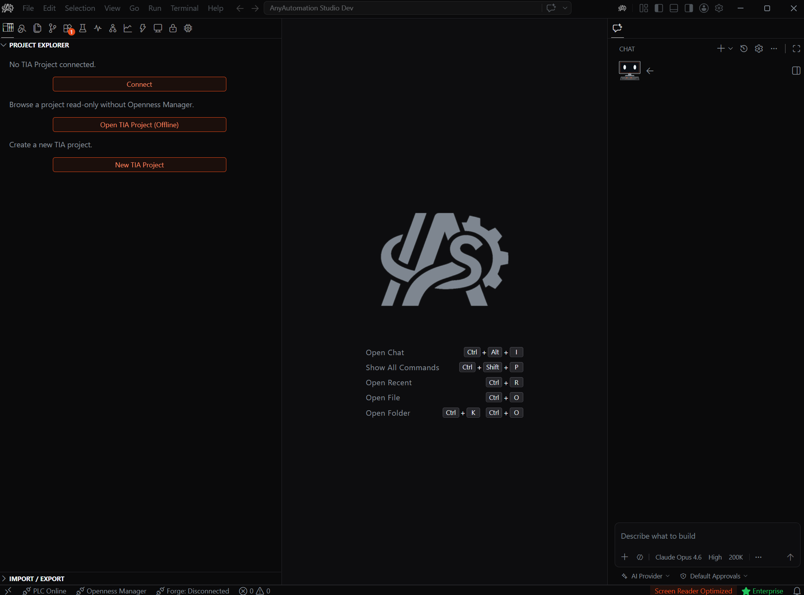

## What is AnyAutomation Studio?

AnyAutomation Studio is a Windows desktop IDE for PLC engineers. It connects to Siemens TIA Portal (V15 through V21, official Openness API) and to CODESYS 3.5, and puts the whole engineering loop into one workspace: an AI assistant that generates, refactors and explains SCL with the real tag names and data types of your project, using the AI provider of your choice (Claude, GPT, Gemini, 20+ cloud providers, or local models via Ollama, LM Studio, vLLM and SGLang); SCL unit tests on PLCSIM Advanced or a real S7 PLC with a CI/CD runner; PLC online monitoring over native S7 and OPC UA; bulk block export and import as Git-friendly text sources; block and project compare; a Git client; a reusable block library (Forge); an EPLAN connector; FUXA web SCADA generation; and an AES-256 password vault for know-how protection.

Full comparison of AI tools for PLC programming: [anyautomation.ch/en/best-ai-for-plc-programming](https://anyautomation.ch/en/best-ai-for-plc-programming).

## Download and Install

1. Download the installer at **[anyautomation.ch/download](https://anyautomation.ch/download)** (`AnyAutomationStudioSetup-x64-*.exe`, system-wide install with one admin prompt; TIA Portal Openness access is registered automatically).
2. Run the installer and launch AnyAutomation Studio.

Studio checks for updates on startup and installs them in the background. New users get a free trial with all features unlocked. If your company network only allows listed addresses, allow `anyautomation.ch` and `downloads.anyautomation.ch`.

What changed in every version: [anyautomation.ch/en/release-notes](https://anyautomation.ch/en/release-notes)

---

## See It in Action

### Three AI Agents, One PLC Project

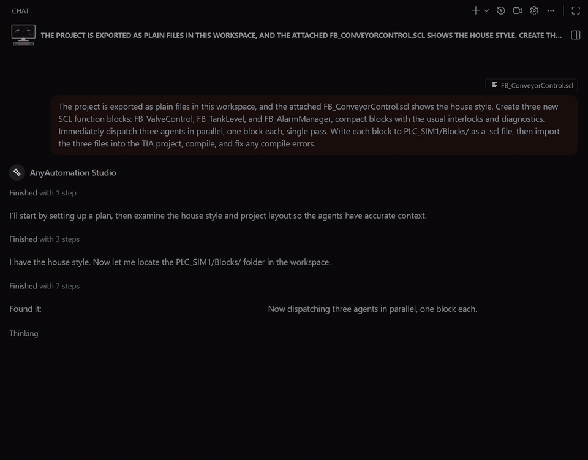

One prompt starts three AI agents that write three PLC function blocks in parallel.

### The AI Writes Graphical Blocks

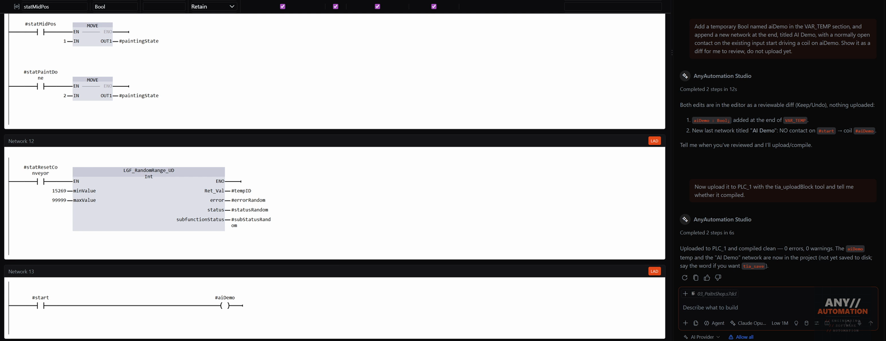

The AI adds a ladder network to a LAD block, uploads it to the PLC and compiles it, and the graphical view shows the result right away.

### PLC Unit Tests

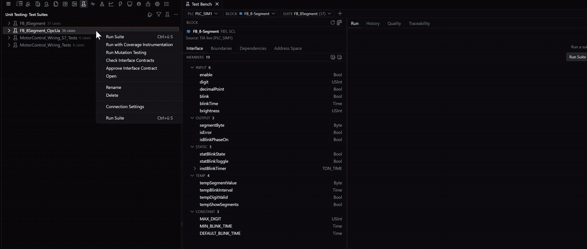

Run a PLC unit test suite against PLCSIM and watch each case turn green in the Test Bench.

### Web SCADA from PLC Signals

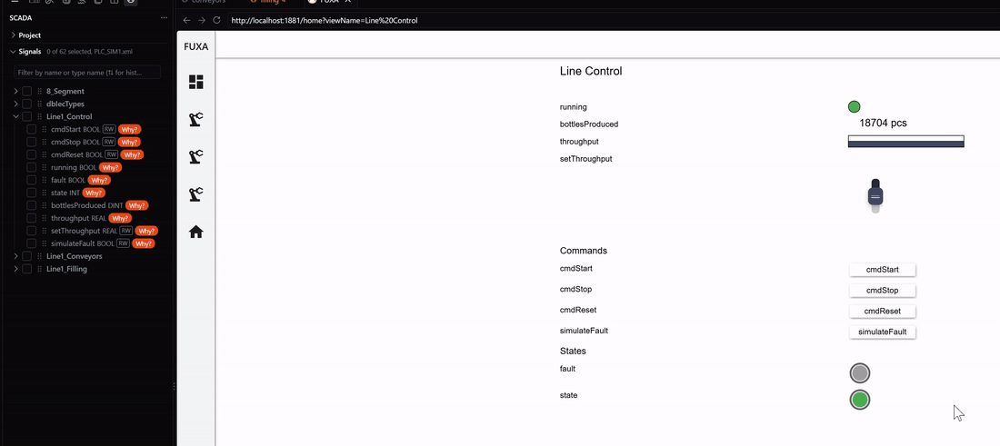

A web SCADA dashboard generated from PLC signals shows live values, and its buttons write back to the PLC.

---

## Watch on YouTube

| | | |
|:---:|:---:|:---:|
|  Three AI Agents, One PLC Project |  AI Writes Graphical PLC Blocks |  Unit Testing for PLC Blocks |
|  The SCADA Workspace |  What Is Forge? |  Compare Two Projects |

All videos: [youtube.com/@AnyAutomation-Studio](https://www.youtube.com/@AnyAutomation-Studio)

---

## Built Around AI

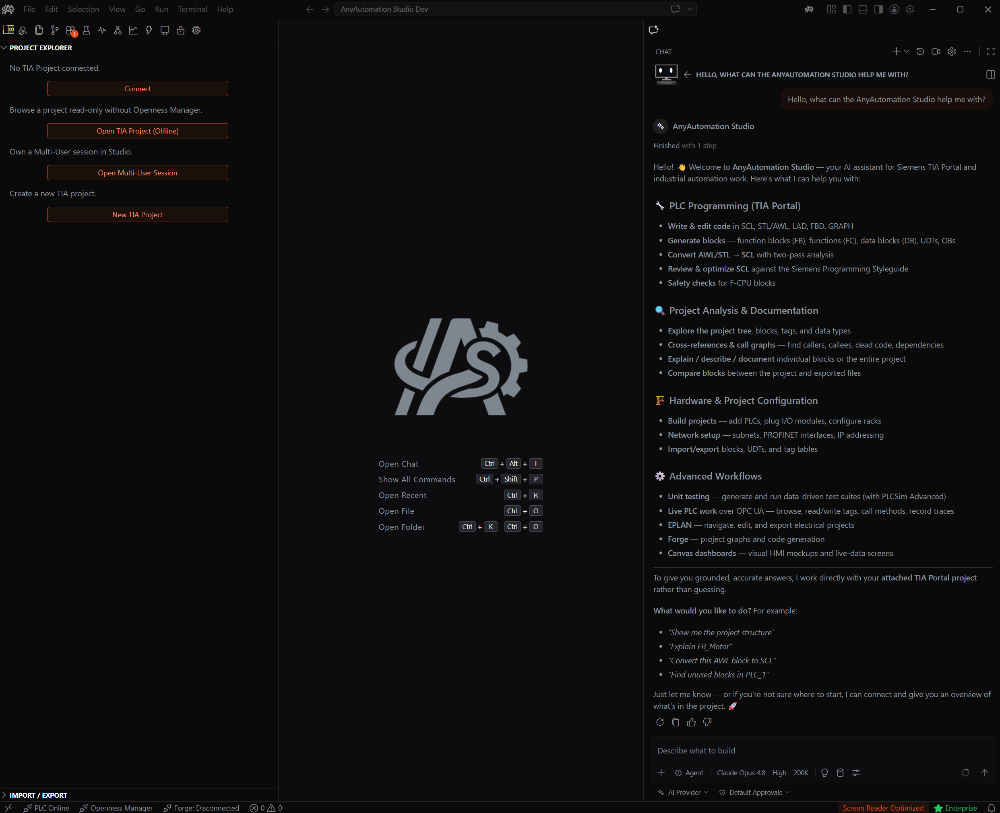

- **AI Cascade:** a project-wide assistant that reads your whole project to ask, generate and refactor with full context (MCP, multi-provider).
- **Agents window:** hand a task to the assistant and let it run: start sessions against local or remote projects, run several in parallel, then review and apply each session's changes.
- **Code generation:** the AI writes SCL blocks, DBs, UDTs and tag tables, and imports them straight into TIA Portal.

---

## Everything in One Workspace

| Capability | What it does |
|---|---|
| **AI Cascade** | Project-wide AI assistant: ask, generate, refactor with full context. |
| **Agents Window** | Run multiple AI agent sessions in parallel, local or remote; review and apply changes. |
| **TIA Portal** | Analyse, export, compare and generate blocks programmatically (V15 to V21, Openness). |
| **CODESYS** | Work with CODESYS 3.5 projects in the same workspace. |
| **Multi-User** | Open, edit and commit TIA Multi-User sessions; upload and check out from a TIA Project Server. |
| **PLC Online** | Live to the controller: watch and write values without TIA Portal open (S7, OPC UA). |
| **Hardware Simulation** | Spin up and control PLCSIM Advanced instances, no physical hardware needed. |
| **Unit Testing** | SCL unit tests on PLCSIM or real hardware, AI-authored, with CI/CD. |
| **Forge** | Reusable block type library and plant graph: capture, organise, deploy into a PLC. |
| **OPC UA** | Browse the address space, read and write, live subscriptions. |
| **Trace** | Oscilloscope-style live signal trace and dashboards. |
| **SCADA** | Generate a [FUXA](https://github.com/frangoteam/FUXA) web SCADA from your PLC's signals and provision it to a running instance. |
| **Import / Export** | Bulk export and import with folder structure, compile and diff. |
| **Find Unused** | Detect and clean up unreferenced blocks across the project. |
| **Password Vault** | AES-256 encrypted vault for know-how protection passwords. |
| **Git Client** | Full version control for your automation project. |
| **EPLAN Connector** | Bridge to EPLAN for electrical engineering data exchange. |

Available in 14 display languages.

---

## Highlights

### TIA Portal Import and Export

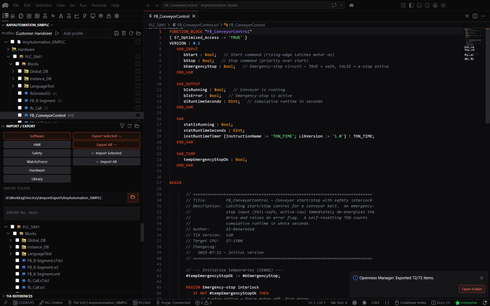

Bulk export and import hundreds of blocks at once in XML, SCL or S7DCL, with the folder structure preserved and automatic compile on import. Software, HMI, Safety, Watch/Force and Hardware are all covered.

### PLC Online and OPC UA

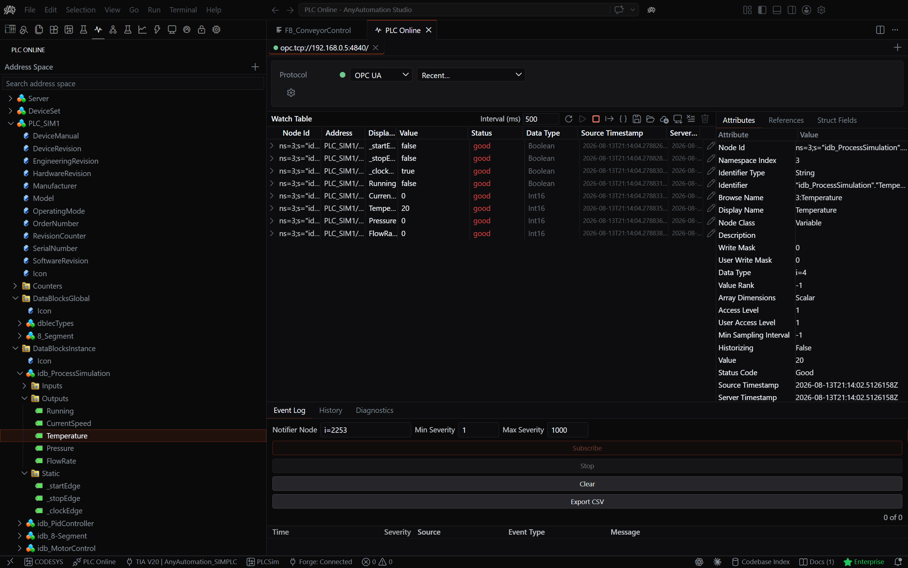

Go live to the controller without TIA Portal open: browse the address space, read and write values, and live-subscribe through native S7 or OPC UA. Save and load watch configurations and export data as CSV or JSON.

### Unit Testing

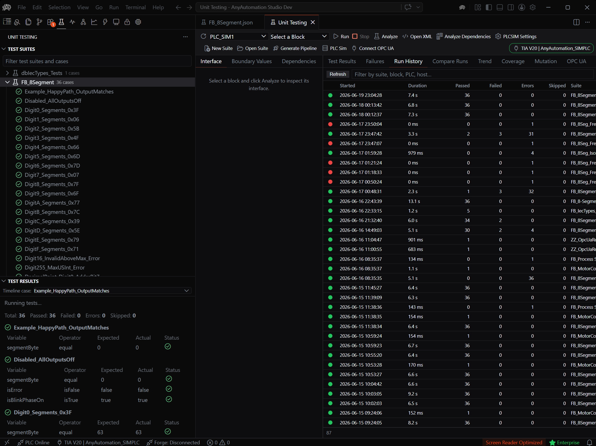

Write, run and evaluate SCL unit tests against PLCSIM Advanced **or a real S7 PLC**. AI-authored test cases, boundary generation, Visual / JSON / SCL editing, persisted pass and fail history, and **CI/CD** integration.

> Simulation-based runs require **PLCSIM Advanced V3.0+** (separate Siemens license).

<strong>More highlights</strong>: Multi-User, Hardware Simulation, Forge, SCADA, Trace, Compare, Code Editor, Protection

### Multi-User Engineering

Open, edit and **commit** a TIA Multi-User session entirely inside Studio, without keeping TIA Portal open. Upload a single-user project to a TIA Project Server and check it out, so a whole team works on one project at the same time.

### Hardware Simulation

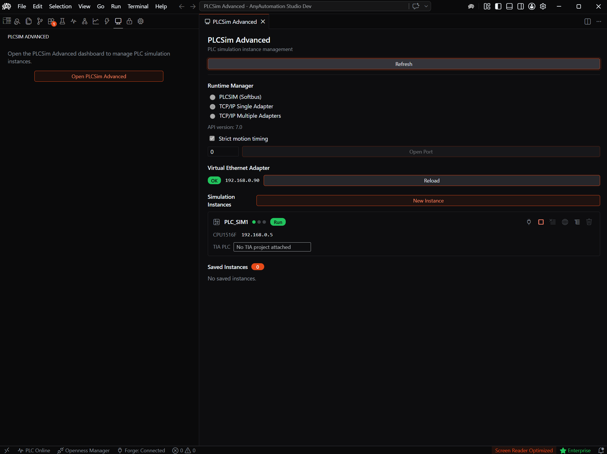

Spin up and control PLCSIM Advanced instances right from Studio, and develop and test without physical hardware.

### Forge

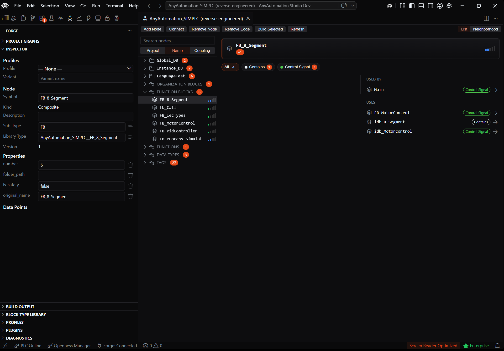

Capture existing blocks into a reusable **Block Type Library**, organise them into folders, and deploy the whole library into any connected PLC. The folder structure is recreated as the group structure inside the PLC.

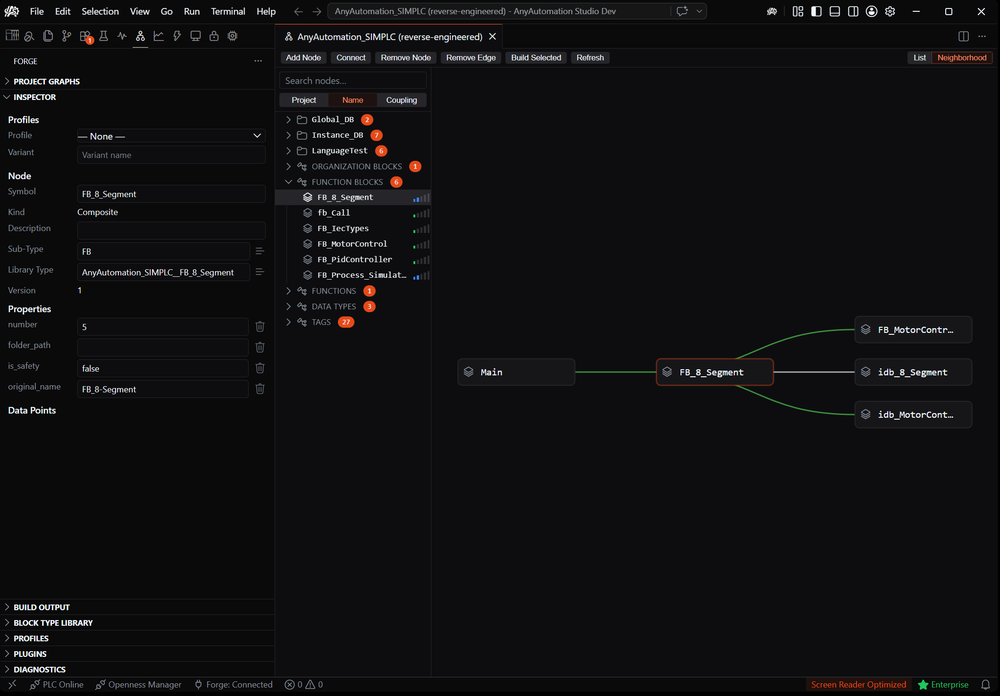

### SCADA: Generate a FUXA Dashboard

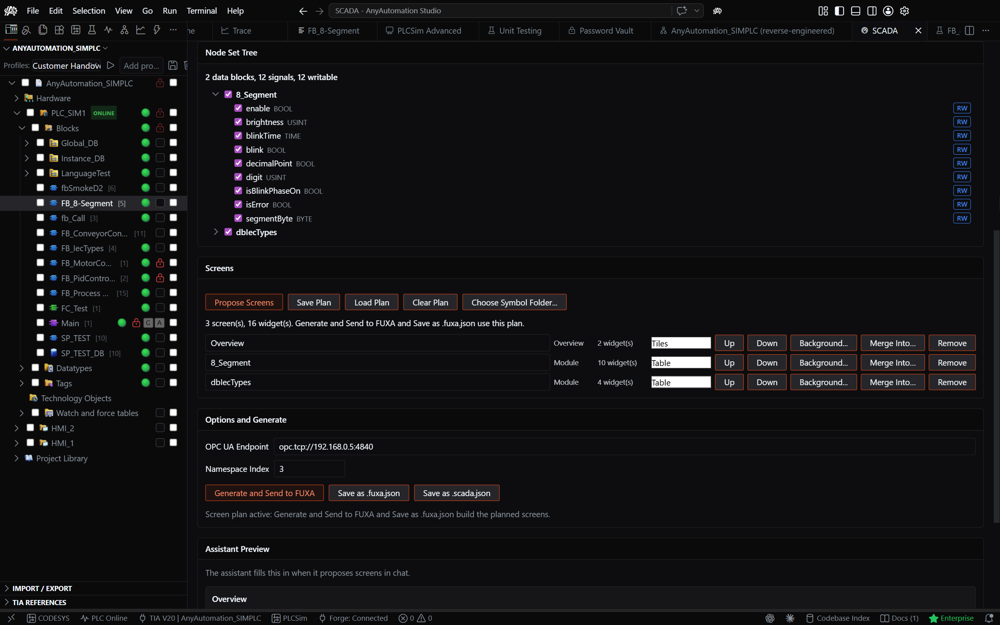

[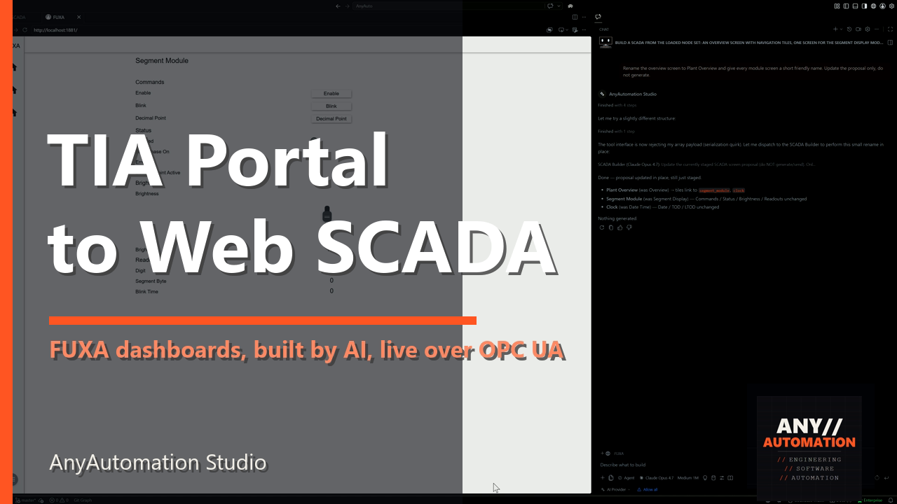](https://www.youtube.com/watch?v=UH5bOJk1R7U)

Turn a CPU's OPC UA nodes into a complete **FUXA** web SCADA: one OPC UA device, a tag per signal, and screens grouped by function. Provision it straight onto a self-hosted FUXA instance, or save it as a project file. Every tag binds to its real OPC UA node id, so live values work immediately. FUXA is open source (MIT) by frangoteam.

### Trace

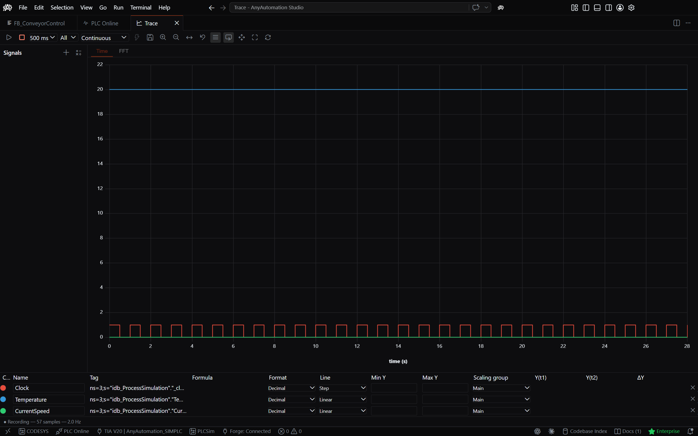

Oscilloscope-style live signal trace and dashboards for watching your process in real time.

### Difference Comparison

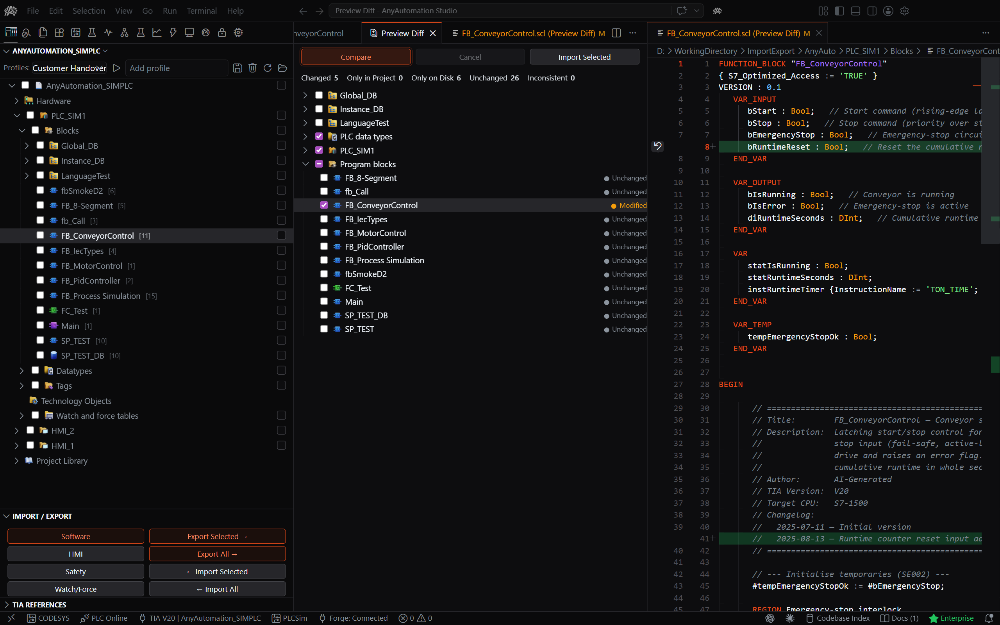

Fast, fingerprint-based diff that detects modified, new and deleted blocks, with a line-by-line viewer and selective re-export.

### Code Editor

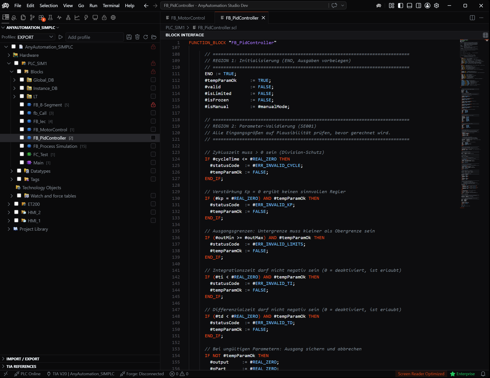

A full editor workbench with SCL syntax highlighting, search and replace, and inline diff. Edit graphical LAD/FBD/GRAPH blocks as editable S7DCL source on TIA Portal V20+.

### Protection and Password Vault

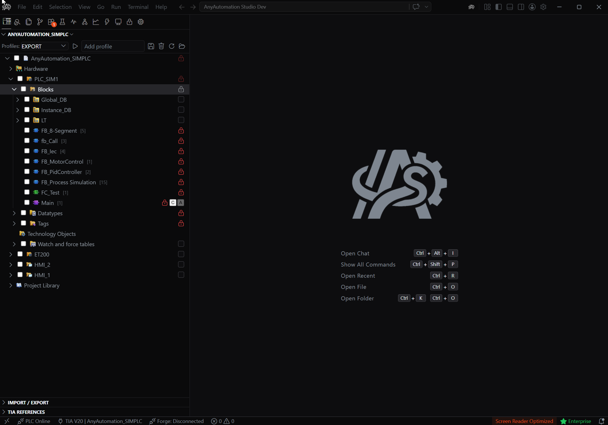

Protect critical blocks against accidental overwrites, and store know-how protection passwords in an AES-256-GCM encrypted vault behind a single master password, with bulk protect and unprotect.

---

## Plans and Pricing

Monthly or yearly, in CHF, cancel any time. Compare the plans at [anyautomation.ch/studio](https://anyautomation.ch/studio#studio-pricing).

## Supported TIA Portal Versions

V15 · V16 · V17 · V18 · V19 · V20 · V21

## Languages

English · Deutsch · Français · Italiano · Español · Português (BR) · Türkçe · Polski · Čeština · Русский · 日本語 · 한국어 · 简体中文 · 繁體中文

---

## Support

- **Website:** [anyautomation.ch](https://anyautomation.ch/)
- **User manual:** [anyautomation.ch/en/docs](https://anyautomation.ch/en/docs)
- **Release notes:** [anyautomation.ch/en/release-notes](https://anyautomation.ch/en/release-notes)
- **YouTube:** [youtube.com/@AnyAutomation-Studio](https://www.youtube.com/@AnyAutomation-Studio)
- **Report a problem:** use **Help** > **Report Issue** in Studio, or open a [GitHub issue](https://github.com/StaniB88/AnyAutomationStudio/issues)

This repository no longer hosts installers; downloads and updates are served from anyautomation.ch.

---

## Disclaimer

**The software is provided "as is" without warranty of any kind.**

The provider assumes no liability for:

- Damages caused by faulty LLM outputs or AI-generated code
- Data loss, production downtime, or system failures
- Engineering errors or faulty code generation
- Damages caused by improper use or configuration

**The user bears full responsibility for reviewing and validating all generated content before use in production systems.**
